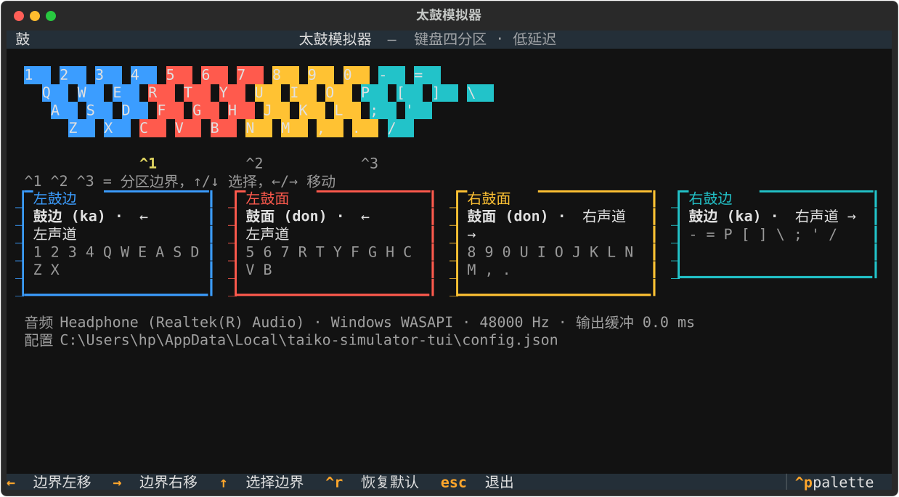

# 太鼓模拟器 (taiko-simulator-tui)

将键盘按物理横向位置划分为四个区域，按键即触发对应音效的低延迟太鼓模拟器。鼓面 (don) 与鼓边 (ka)
分别输出至左、右声道。界面基于 [Textual](https://textual.textualize.io/) 实现，区域边界支持可视化调整，
改动即时持久化。




## 特性

- **四区即时触发**：键盘按物理横向位置（含各行交错偏移）划分为四条纵向区域，无需记忆离散键位
- **低延迟**：按键至发声实测 25–30 ms；击鼓热路径中位数为 0.04 ms，无内存分配
- **声道分离**：左区仅输出至左声道，右区仅输出至右声道，实测串音为 0
- **可视化配置**：使用 `←` / `→` 调整分界位置，改动即时写入配置文件
- **长按抑制**：持续按住按键仅触发一次
- **跨平台**：Windows 与 macOS 共用同一套实现

## 运行

要求 Python 3.14 及以上，推荐使用 [uv](https://docs.astral.sh/uv/)：

```bash
git clone https://github.com/rogerwang2008/taiko-simulator-tui.git
cd taiko-simulator-tui
uv sync
uv run taiko-simulator-tui
```

## 区域划分

| 区域 | 音效 | 声道 | 颜色 | 默认按键 |
| --- | --- | --- | --- | --- |
| 左鼓边 | rim (ka) | ← 左 | 蓝 `#3b9dff`（冷） | `1 2 3 4 Q W E A S D Z X` |
| 左鼓面 | center (don) | ← 左 | 红 `#ff5a4d`（暖） | `5 6 7 R T Y F G H C V B` |
| 右鼓面 | center (don) | 右 → | 琥珀 `#ffc233`（暖） | `8 9 0 U I O J K L N M , .` |
| 右鼓边 | rim (ka) | 右 → | 青 `#22c3c9`（冷） | `- = P [ ] \ ; ' /` |

鼓面采用暖色、鼓边采用冷色，四个区域的色相互不相同（相邻区域相差 206° / 38° / 140°），
以保证两条分界线在键盘视图与面板上均清晰可辨。

区域依据每个键的**物理横向位置**（含各行交错偏移）划分，因此得到的是连续的纵向切片，而非离散键位集合。

## 按键

| 按键 | 作用 |
| --- | --- |
| 布局内任意键 | 触发所属区域的音效，并给出闪烁反馈 |
| `↑` / `↓` | 选择待调整的分界 `^1` / `^2` / `^3` |
| `←` / `→` | 以 0.25 键位为步长移动所选分界 |
| `Ctrl+R` | 恢复默认分区 |
| `Esc` / `Ctrl+Q` | 退出 |

分界位置每次调整后立即写入配置文件，无需确认。

## 长按抑制

持续按住某个按键时，操作系统会以固定频率重复发送按键事件，而终端不提供按键释放事件（仅在 kitty
键盘协议的 event-type 标志下才会上报，Textual 未申请该标志，多数终端亦未实现）。因此本实现依据事件
**时间间隔**判定长按：同一按键两次事件的间隔小于 60 ms 时，判定为系统重复而非人工输入。

- 长按 2 秒（Windows 默认：500 ms 延迟、33 ms 间隔）：触发次数由约 30 次降至 2 次
- 单手连打 12 次/秒、双手交替 20 次/秒、同键双击 100 ms：均完整保留，不丢音

60 ms 这一门限的选取依据是：它低于各平台的最快重复间隔（Windows 最快约 33 ms，macOS 约 15–30 ms），
同时高于人类在同一按键上连打的速度上限。该取向的取舍是宁可漏判系统重复，也不丢弃真实敲击。

## 配置

分区边界保存在**运行目录**下的 `config.json`：

```json
{ "version": 1, "boundaries": [3.25, 6.25, 9.5] }
```

`boundaries` 为三个分界位置，单位为键位（键盘横向范围为 0–12.5）。该文件已列入 `.gitignore`。
文件缺失、损坏或数值非法时回退至默认分区。

## 延迟

按键至发声的实测预算（Headphone Realtek / WASAPI 共享模式 / 48 kHz）：

| 环节 | 实测 |
| --- | --- |
| 击鼓热路径（`on_key` → 写入环形缓冲） | 中位数 **0.04 ms**（无内存分配，单写单读） |
| 设备输出缓冲 | **22.0 ms**（WASAPI 共享模式下的可用下限） |
| 回调成簇触发，新数据被拾取 | 平均等待 **~5 ms** |
| 合计 | **约 25–30 ms** |

实现为一个常驻输出流加环形缓冲：触发时将预先分好声道的样本**加性写入读指针处**，因此并发敲击自然
混音，快速连打时由回调中的 `np.clip` 限幅。

样本加载阶段做三项处理，目的是让发声起点与按键时刻对齐：

1. **裁除前导静音**：原始 mp3 每次敲击前含约 70 ms 静音，若保留将直接转化为同等可感延迟
2. **裁除尾部静音**：11.08 s 的素材中有效声音仅 1.5–1.8 s
3. **峰值归一至 0.6**：原始 rim 峰值仅为 center 的四分之一，不归一化将导致鼓边几乎不可闻；
   保留余量是因为左右手常同时击打

> 独占模式实测可达 4.3 ms，但其会独占音频设备、导致其他应用静音，因此本实现有意不采用，
> 以便与其他音频共存。

## 跨平台

Windows 与 macOS 运行同一套代码，差异仅两处，且均以 `sys.platform` 隔离：

| 差异 | Windows | macOS / Linux |
| --- | --- | --- |
| 输出设备 | 显式选用 WASAPI（PortAudio 默认的 MME 会多出约 100 ms 缓冲） | 当前 host API 的默认输出设备 |
| 控制台编码 | 切换至 UTF-8（旧代码页如 cp936 无法编码 Textual 字形，会导致输出线程抛出异常并静默停止刷新），退出时还原 | 空操作 |

配置读写、音频素材、键盘布局解析均不含平台相关假设。

## 项目结构

```
src/taiko_simulator_tui/
  audio.py      解码 / 裁剪 / 归一 / 重采样，环形缓冲与输出流
  keyboard.py   键盘布局、交错偏移、分区解析、边界钳制、长按判定
  config.py     配置读写与校验
  app.py        Textual 界面
  assets/audio/ center1.mp3 鼓面、rim1.mp3 鼓边
```

## 已知限制

- **长按会触发两次**：首次系统重复（约 500 ms 后）与「用户确实再次按下」在时间特征上完全一致，
  且终端不提供按键释放事件，二者无法区分。该现象仅在持续按住时出现，正常敲击不受影响。
- **调慢系统重复频率会削弱长按抑制**：若将重复间隔设为 ≥ 60 ms，该间隔已落入人工输入范围，
  无法与真实敲击区分。
- **分区仅覆盖主键区四行**（数字行、Q 行、A 行、Z 行），不包含空格键与功能键。
